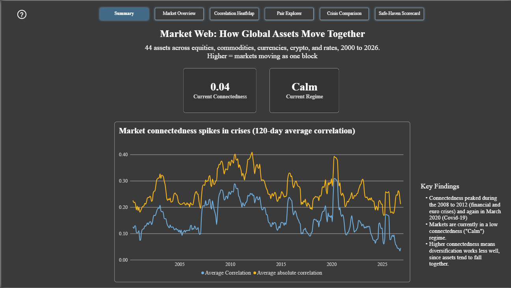
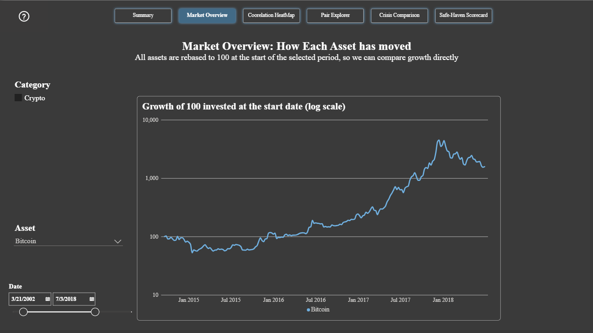
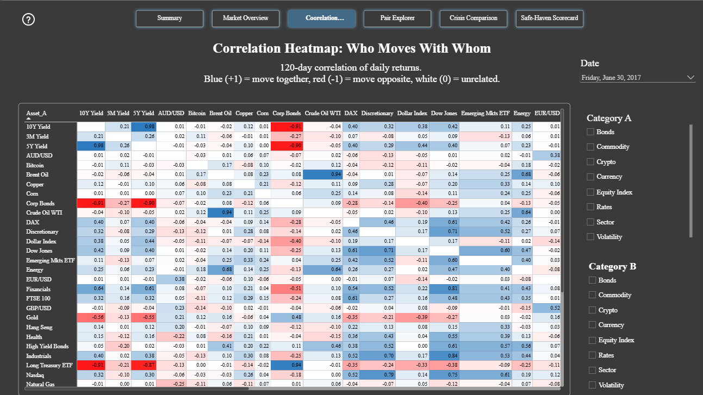
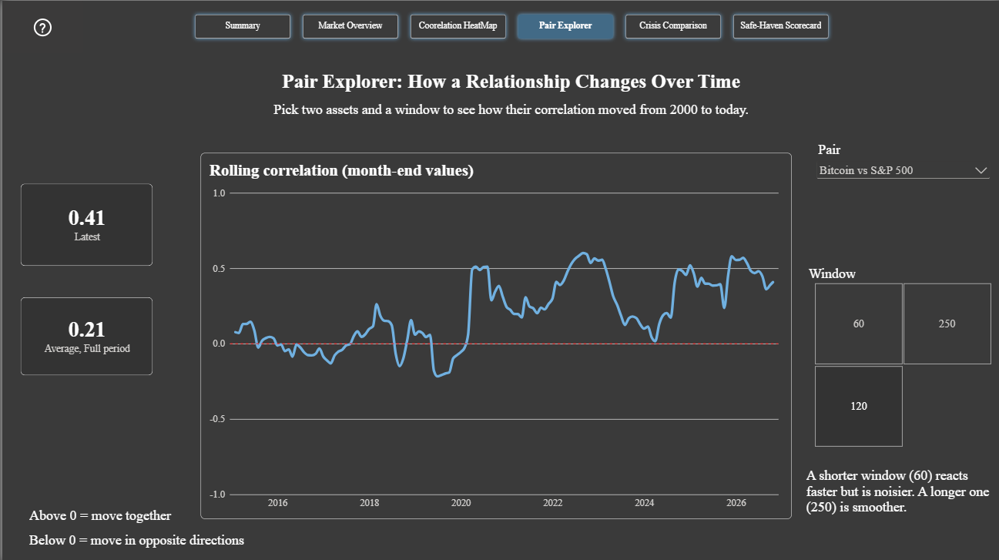
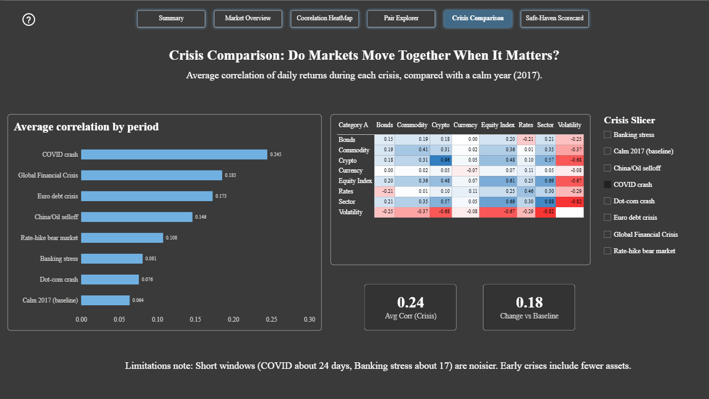
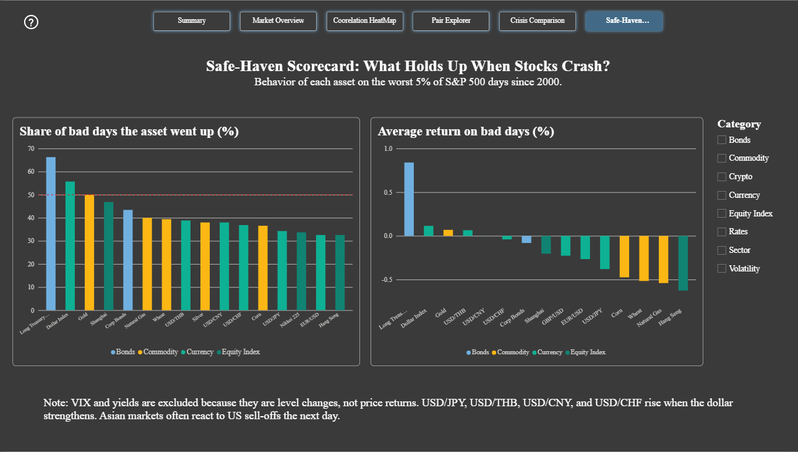

# Market Web: How Global Assets Move Together

> Do global assets (stocks, commodities, currencies, crypto, bonds) move together, and do those relationships tighten in a crisis? A Python analysis of 44 assets from 2000 to 2026, delivered as a 6-page interactive Power BI dashboard.



## Why this project

Three beliefs are common in investing:

- Gold is a safe haven that holds up when markets fall.
- Bitcoin is "digital gold" and moves independently of stocks.
- Spreading money across different assets protects you in a crash.

This project tests those beliefs with 26 years of daily data. Some hold, some do not, and some hold only in certain periods.

## Key findings

| # | Finding | Evidence |
|---|---|---|
| 1 | **Markets move together far more in a crisis.** | Average correlation was 0.064 in calm 2017, versus 0.245 in the COVID crash (about 4x), 0.185 in the Global Financial Crisis and 0.173 in the Euro debt crisis. |
| 2 | **Not every crisis is equal.** | The Dot-com crash (0.076) and 2023 banking stress (0.081) were only slightly above the calm baseline. Short windows and fewer assets in the early years make these noisier. |
| 3 | **Connectedness changes over time.** | It peaked during 2008 to 2012 and spiked again in March 2020. Today it is low (average correlation 0.04, regime "Calm"). |
| 4 | **Bitcoin's link to stocks is not fixed.** | Its 120-day correlation with the S&P 500 hovered around zero from 2015 to 2019, rose to about 0.5 in 2020, peaked near 0.6 in 2022, and fell to about zero again in 2024. The latest value is 0.41 versus a full-period average of 0.21. |
| 5 | **Treasuries protected, gold was a coin flip.** | On the worst 5% of S&P 500 days, long-term Treasuries rose about 66% of the time (average +0.84%). Gold rose 50% of the time (average +0.07%). |
| 6 | **Most other assets fell with stocks.** | Commodities such as natural gas, wheat and corn averaged losses of roughly 0.5% on bad days. Bitcoin did not rank among the top 15 assets by hit rate. |
| 7 | **The dollar, yen and franc held up better than most.** | The Dollar Index rose on about 56% of bad days. USD/JPY and USD/CHF rose on only about a third of them, meaning the yen and franc strengthened on roughly 60 to 65% of the worst days. |

Diversification works less well when connectedness is high, because assets tend to fall together at the moment protection is needed most.

## Dashboard

The Power BI report has six pages, linked by a navigation bar.

### 1. Summary
Latest connectedness, current regime, and the average pairwise correlation over time (120-day window). The line spikes in known crises.

### 2. Market Overview
Every asset rebased to 100 at the start of the selected period, on a log scale, so growth can be compared directly. Filters for category, asset and date range.



### 3. Correlation Heatmap
The "relationship map": 120-day correlations for every asset pair, for any month-end date. Blue means moving together, red means moving in opposite directions. Comparing a crisis month with a calm month shows how the web tightens. In June 2017, for example, Brent oil and the Dow Jones had a correlation of about 0.14, versus about 0.51 at the end of March 2020.



### 4. Pair Explorer
Pick any two assets and a window (60, 120 or 250 days) to see how their correlation changed from 2000 to today, with the latest and full-period average values.



### 5. Crisis Comparison
Average correlation in each of seven crisis periods against a calm 2017 baseline, plus a category-by-category matrix for the selected crisis. In the COVID crash, crypto, sectors and equities were tightly linked (for example 0.96 within crypto and 0.88 within sectors), while the VIX was strongly negative against equities (about -0.67).



### 6. Safe-Haven Scorecard
What each asset did on the worst 5% of S&P 500 days since 2000: the share of those days it rose, and its average return.



## Data

| Source | What | Notes |
|---|---|---|
| Yahoo Finance (`yfinance`) | Daily prices, 2000 to 2026, 44 assets | No API key needed |
| FRED (`fredapi`) | 8 macro series (Fed funds rate, CPI, unemployment, M2, yield curve, real yield, high-yield spread, recession flag) | Collected for future work, not used in the current dashboard |

**Asset universe (44):**

| Category | Assets |
|---|---|
| Equity indices | S&P 500, Nasdaq, Dow Jones, FTSE 100, DAX, Nikkei 225, Hang Seng, Shanghai, Thai SET, Emerging Markets ETF |
| Commodities | Gold, Silver, WTI and Brent oil, Natural gas, Copper, Wheat, Corn |
| Currencies | Dollar Index, EUR/USD, USD/JPY, GBP/USD, USD/THB, USD/CNY, AUD/USD, USD/CHF |
| Crypto | Bitcoin, Ethereum |
| Rates | 10-year, 5-year and 3-month US yields |
| Bonds | Long Treasury ETF, High yield bonds, Corporate bonds |
| US sectors | Tech, Energy, Financials, Health, Utilities, Staples, Discretionary, Industrials, Real estate |
| Volatility | VIX |

Some assets start later than 2000 (Bitcoin 2014, Ethereum 2017, some bond ETFs 2002 to 2007). A coverage report is saved in `data/clean/coverage_report.csv`.

## Method

1. **Collect** prices in batches and save raw data to Parquet, so nothing is downloaded twice.
2. **Clean**: remove non-positive prices (oil traded below zero in April 2020), keep weekdays only, forward-fill gaps of up to 3 days, and drop daily moves above 50% as data errors.
3. **Convert to returns**: log returns for prices, simple differences for yields and the VIX (they are levels, not prices).
4. **Rolling correlations** over 60, 120 and 250 days for every pair, stored at month-end (about 739,000 rows).
5. **Connectedness**: the average pairwise correlation over time, using only assets that exist since 2000 so early and recent years are comparable. Months are split into Calm, Elevated and Stressed regimes by terciles.
6. **Crisis comparison**: correlations during seven crisis windows versus a calm baseline (2017).
7. **Safe-haven scorecard**: returns of each asset on the worst 5% of S&P 500 days.
8. **Dashboard**: star-schema model and DAX measures in Power BI.

### Key technical decisions

| Decision | Reason |
|---|---|
| Correlate returns, not prices | Any two trending series look correlated by accident |
| Differences for yields and VIX | They are levels and can be near zero, so percent returns are not meaningful |
| Fixed core asset set for the connectedness line | Otherwise the average changes simply because new assets enter the sample |
| Plain and absolute average correlation | Positive and negative correlations can cancel each other out |
| Month-end rolling values | Keeps Power BI fast while preserving the shape of the history |
| Mirrored pair table for the heatmap | Fills both halves of the matrix so the grid is complete |
| Safe-haven return charts exclude VIX and yields | Their changes are in points, not percent returns |

### Power BI model

- **Dimensions:** `dim_asset`, `dim_crisis`, `DimDate`
- **Facts:** weekly prices and returns, rolling correlations, a mirrored correlation matrix, crisis correlations, connectedness, safe-haven scores
- **Measures (DAX):** average correlation (matrix, pair, crisis), current connectedness and regime, rebased-to-100 index, change versus baseline, latest and long-run pair correlation

## Crisis periods used

| Crisis | Start | End |
|---|---|---|
| Calm baseline (2017) | 2017-01-03 | 2017-12-29 |
| Dot-com crash | 2000-03-10 | 2002-10-09 |
| Global Financial Crisis | 2007-10-09 | 2009-03-09 |
| Euro debt crisis | 2011-07-01 | 2011-10-04 |
| China/Oil selloff | 2015-08-10 | 2016-02-11 |
| COVID crash | 2020-02-19 | 2020-03-23 |
| Rate-hike bear market | 2022-01-03 | 2022-10-12 |
| Banking stress | 2023-03-08 | 2023-03-31 |

## Project structure

```
market-web/
├── README.md
├── notebooks/
│   ├── collect.ipynb          # download prices (Yahoo) and macro data (FRED)
│   ├── clean_returns.ipynb    # cleaning, coverage report, daily and weekly returns
│   ├── analysis.ipynb         # rolling correlations, connectedness, crises, safe havens
│   └── export.ipynb           # tables for Power BI
├── data/
│   ├── raw/                      # untouched downloads (not in the repo)
│   ├── clean/                    # processed data (not in the repo)
│   └── powerbi/                  # CSVs loaded into Power BI (not in the repo)
└── dashboard/
    ├── market-web.pbix
    └── images/
```

## How to reproduce

```bash
pip install yfinance pandas numpy matplotlib seaborn scikit-learn pyarrow fredapi
```

1. Get a free API key from [fred.stlouisfed.org](https://fred.stlouisfed.org) and set it as an environment variable named `FRED_API_KEY`. Never commit the key.
2. Run the notebooks in order. The first run downloads about 25 years of data and can take a few minutes.
3. Open `dashboard/market-web.pbix` in Power BI Desktop and point the data source to `data/powerbi/`.

## Limitations

- Short crisis windows (COVID is about 24 trading days, banking stress about 17) give noisy estimates.
- Early periods include fewer assets, because several did not exist yet.
- Asian markets close before the US session, so same-day correlations with US assets are understated and some US sell-offs show up in Asia the next day.
- Futures-based series (gold, oil, and others) can show small jumps at contract rollovers.
- Regimes are terciles, so "Stressed" means high relative to 2000 to 2026, not an absolute threshold. A third of months are always in each regime.
- Currency pairs are quoted in different directions: EUR/USD, GBP/USD and AUD/USD rise when the dollar weakens, while USD/JPY, USD/THB, USD/CNY and USD/CHF rise when it strengthens.
- Correlation is not causation, and past relationships may not repeat.

## Future work

- Add the macro drivers page (FRED data is already collected) to explain why connectedness rises and falls.
- Add a PCA-based connectedness measure (absorption ratio) and a market network graph.
- Compare safe-haven behavior across eras (2000 to 2007, 2008 to 2012, 2013 to 2019, 2020 onward).
- Refresh the data automatically on a schedule.

## Tools

Python (pandas, NumPy, matplotlib, scikit-learn), `yfinance`, `fredapi`, Parquet, Power BI Desktop, DAX.

## Disclaimer

This is an educational project that describes past relationships. It is not financial advice and not a trading strategy.

---

